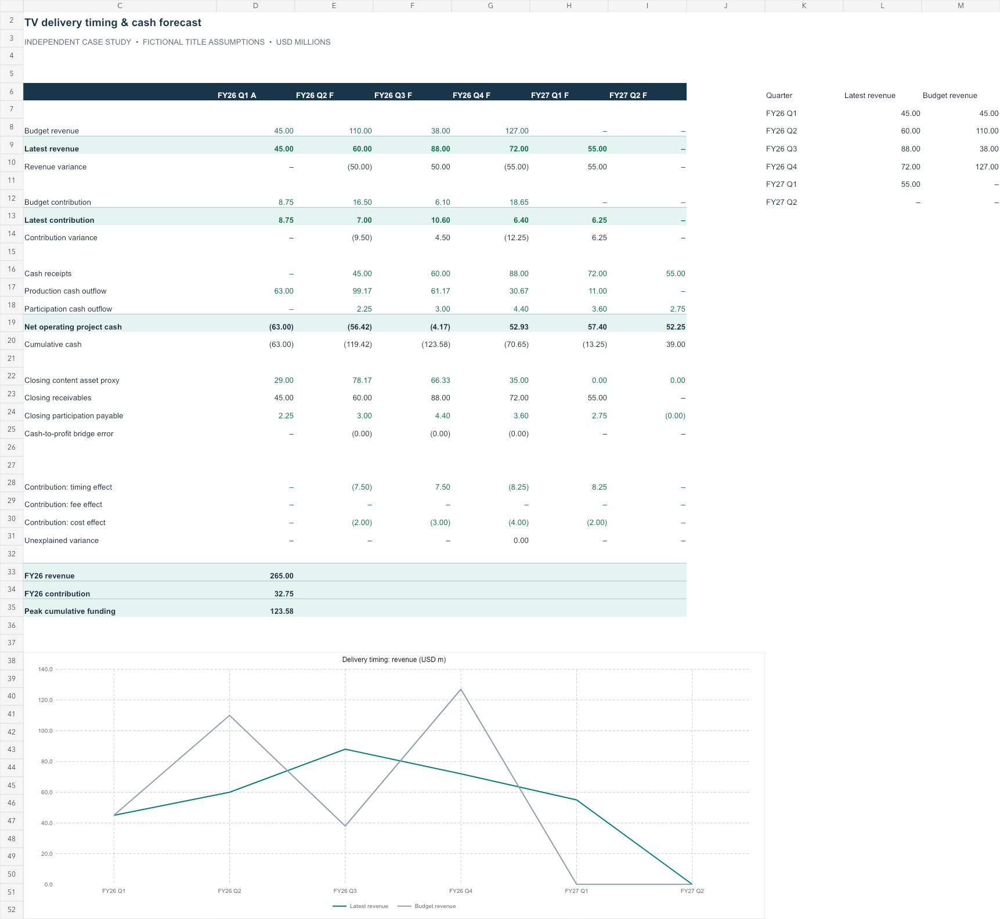

# SlateCast | TV Delivery & Cash Forecasting

**Independent entertainment FP&A case study · Excel + Python + SQL**

A six-series model that answers: **Is a revenue miss a timing problem, a weaker deal, or a production-cost problem—and when does cash recover?**

Sony's July 2026 reporting identified lower TV series deliveries as a contributor to the Pictures sales decline. This project demonstrates a practical response: connect a delivery calendar to a quarterly forecast, explain the variance, and size the funding requirement. [Public reporting and role context](SOURCES.md)

> All series, contracts, costs and modeled outcomes are fictional. This is an independent portfolio simulation, not work performed for Sony or a forecast of Sony's business. The public segment figures provide context only.

## Review in 90 seconds

1. Read the [management memo](EXECUTIVE_MEMO.md).
2. Download the [editable Excel model](financial-model.xlsx?raw=true); begin on **Forecast**, then edit blue cells on **Inputs**.
3. Inspect the [Python model](model.py), executable [SQL aggregation](analysis.sql), and [results](results/metrics.json).



## What the fictional slate reveals

| Metric | Result, USD millions |
|---|---:|
| FY26 budget revenue | 320.00 |
| FY26 latest revenue | 265.00 |
| Revenue moving beyond year-end | 55.00 |
| FY26 budget project contribution | 50.00 |
| FY26 latest project contribution | 32.75 |
| Contribution variance: delivery timing | (8.25) |
| Contribution variance: higher production cost | (9.00) |
| Peak cumulative funding, before financing | 123.58 |

The $55m annual revenue gap is timing in this example; total modeled license revenue remains $320m. That does **not** make the miss harmless: production spending precedes collections, and cost increases permanently reduce full-horizon contribution by $11m.

## Skills demonstrated

- **Budget and quarterly forecasting:** title-level delivery dates, fee assumptions and estimate-at-completion costs.
- **Variance analysis:** an order-defined timing → fee → cost bridge with zero unexplained residual.
- **Cash forecasting:** receivables, production asset and participation payable roll-forwards reconcile contribution to cash.
- **Management communication:** owners, actions, constraints and monitoring metrics in a short decision memo.
- **Data discipline:** SQL aggregation at a defined grain, stable series IDs, checks for duplicates and impossible schedules.

These capabilities map to the U.S. Scripted TV Production FP&A responsibilities in JR114637. They are a suggested demonstration of fit, not projects Sony has stated applicants must submit.

## Run locally

Requires Python 3.10+; no third-party Python packages or credentials.

```sh
python3 model.py
python3 -m unittest -v
```

The first command regenerates the CSV and JSON analytical outputs from `data/series.csv`; the second runs seven tests. Excel calculates independently from the same initial inputs. Changes in Excel do not write back to CSV, and running Python does not overwrite the workbook. Update both deliberately when comparing a new case. The memo and preview describe the committed baseline.

## Model scope

FY26 means April 2026–March 2027. Q1 is closed; Q2–Q4 are forecasts; two spillover quarters show delayed delivery and collection. No actual Sony title data is used. Contribution expenses the full modeled production cost at delivery; it is a **project decision metric**, not IFRS operating income. See [model definitions and controls](MODEL_GUIDE.md) before using a result.

Seven Python tests passed. Workbook headline outputs and all quarterly bridges were reconciled to Python; a delivery-date change was tested and restored. All sheets were visually reviewed and the workbook formula scan returned no errors. Native Microsoft Excel execution was not tested.
